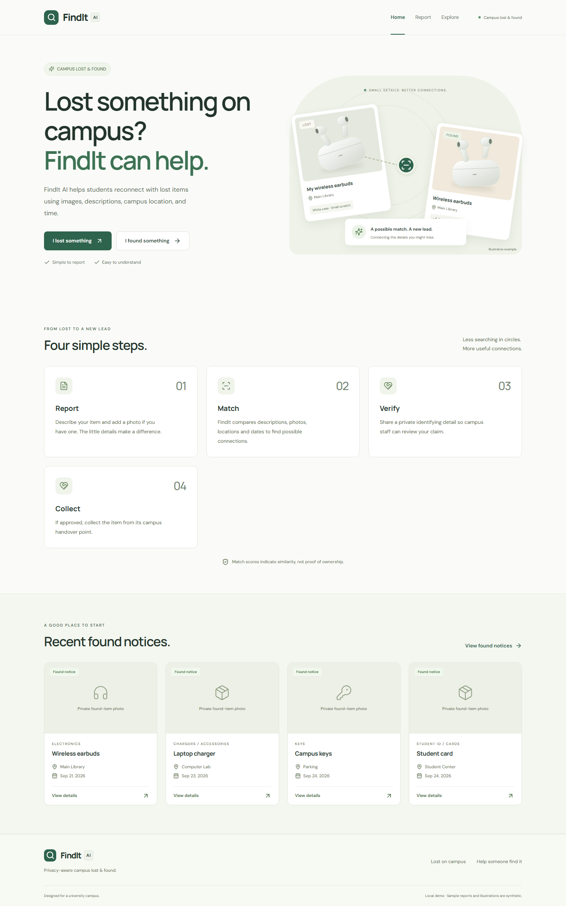
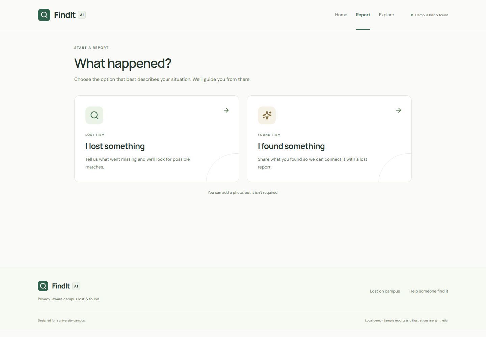
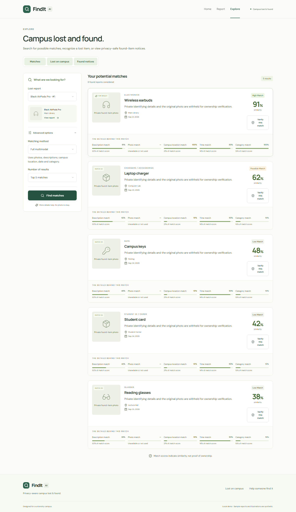
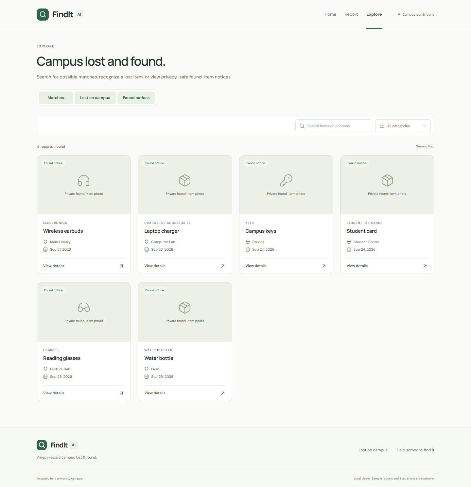
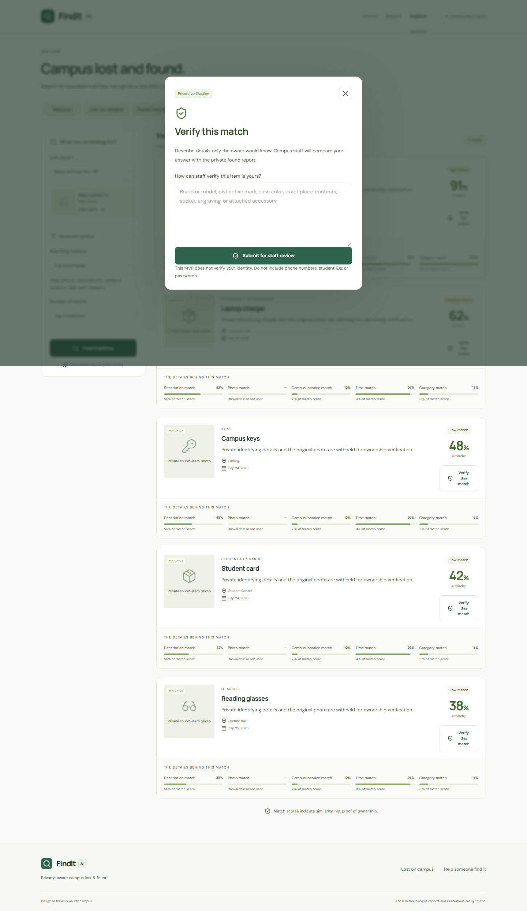
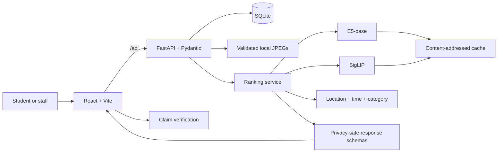

# FindIt AI — Privacy-Aware Multimodal Lost-and-Found Matching

**A full-stack AI retrieval system for university campuses.** FindIt ranks likely matches from descriptions, photos, campus location, date, and category while withholding the details that a claimant should have to prove ownership.

| | |
|---|---|
| **Stack** | React, TypeScript, FastAPI, SQLAlchemy, SQLite, PyTorch |
| **Models** | E5-base text embeddings + SigLIP image embeddings |
| **Evaluation** | Frozen 16-query synthetic test: **Recall@1 0.8125**, **Recall@3/5 1.000**, **MRR 0.9063** |
| **Engineering** | Privacy-safe response schemas, missing-signal normalization, content-addressed embedding cache, reproducible dev/test benchmarks |

> The benchmark is deliberately small and synthetic. These numbers validate the evaluation and ranking pipeline; they do not claim real-world campus accuracy.



## Product walkthrough

| Report an item | Review ranked matches |
|---|---|
|  |  |

| Browse privacy-safe found notices | Verify a claim privately |
|---|---|
|  |  |

Every screen uses synthetic fixtures. Additional views: [mobile home](docs/screenshots/home-mobile.png), [report form](docs/screenshots/report-desktop.png), and [match search](docs/screenshots/explore-matches.png).

## Problem and solution

Campus lost-and-found systems often depend on manual browsing and literal wording. Two descriptions of the same item may use different terms, while publishing every detail of a found item makes false claims easier.

FindIt combines semantic text retrieval, visual similarity, and campus context. It ranks candidates while keeping ownership clues private and routes promising matches into a verification workflow.

## How it works

1. A student submits a lost or found report, optionally with a photo.
2. FastAPI validates the report and re-encodes uploads as metadata-free JPEGs.
3. For a lost report, FindIt compares E5 text and SigLIP image embeddings and adds location, time, and category evidence.
4. Missing signals are omitted and the remaining weights are normalized.
5. The UI returns ranked, privacy-safe previews with an explanation of each score.
6. A claimant supplies private identifying evidence; staff approve or reject the claim and set a collection point.

Found-item descriptions, identifying marks, exact sub-locations, images, handover details, and finder information are excluded from public API responses. Matching can use those fields internally. A score is a ranking heuristic, not a probability or proof of ownership.

## Architecture



Models load lazily and remain in memory. Evaluation calls the same ranking service as the API and does not depend on the application database. The current corpus uses an exhaustive candidate scan; a controlled FAISS experiment found no reason to add an index at this scale.

The available-signal score is:

`score = sum(weight_i * similarity_i) / sum(available weight_i)`

| Signal | Weight | Implementation |
|---|---:|---|
| Text | 0.35 | Clipped cosine similarity of E5-base embeddings |
| Image | 0.30 | Clipped cosine similarity of SigLIP embeddings |
| Location | 0.15 | Exact or normalized fuzzy campus-location similarity |
| Time | 0.10 | 14-day exponential decay with an early-found penalty |
| Category | 0.10 | Exact, `Other`, or conflicting-category score |

## Evaluation design

The model stack and weights were selected on the 24-query `campus_v1` development split, frozen, and evaluated once on a disjoint 16-query test split with 32 candidates.
Development data was available for encoder selection and weight experiments. Test reports, labels, and image hashes were isolated and locked; the final evaluator refuses a second run. See the [benchmark protocol](data/benchmark/campus_v1/README.md) and [frozen configuration](data/evaluation/campus_v1/final/frozen_config.json).

## Why these models and retrieval choices?

| Decision | Controlled comparison | Selected result |
|---|---|---|
| Text encoder | MiniLM vs BGE-base vs E5-base; same reports, image model, weights, and ranking pipeline | **E5-base**: full-ranking dev Recall@1 0.917 vs 0.750 and 0.542 |
| Image encoder | CLIP vs SigLIP vs DINOv2 on hard-view COIL-100 exact-object retrieval | **SigLIP**: hard Recall@5 0.922 and MRR 0.908 |
| Multimodal weights | 204 development-only combinations | Retained 0.35 / 0.30 / 0.15 / 0.10 / 0.10 |
| Vector retrieval | NumPy brute force vs exact FAISS `IndexFlatIP` vs HNSW through 100k vectors | Retained brute force for the current small corpus |

Full artifacts: [text encoders](data/evaluation/campus_v1/text_embedding_comparison/results.md), [image encoders](data/evaluation/image_retrieval/coil100_v1/comparison.md), [weight search](data/evaluation/campus_v1/weight_tuning/top_candidates.md), and [FAISS scalability](data/evaluation/vector_retrieval/faiss_v1/results.md). Latencies are machine-specific warm-cache measurements.

## Held-out evaluation

The frozen E5 + SigLIP system achieved Recall@1 of **0.8125** and MRR of **0.9063** on a 16-query held-out synthetic campus benchmark. **13 of 16** correct matches ranked first, and the correct item appeared within the top three for every query. No tuning followed this run.

| Metric | Final held-out result |
|---|---:|
| Recall@1 | 0.8125 |
| Recall@3 | 1.0000 |
| Recall@5 | 1.0000 |
| MRR | 0.9063 |

### Failure analysis

The three top-1 misses expose different ranking limits:

- **Silver signet ring:** the query had no image, and a nearly identical negative received a slightly higher text score.
- **Olive lunch container:** the relevant image scored better, but the negative's stronger text similarity narrowly won after fusion.
- **Insulated travel mug:** the relevant candidate had the stronger image match, but a conflicting date signal pushed it to rank two.

The score gaps and component values are documented in the [frozen failure analysis](data/evaluation/campus_v1/final/failures.md).

## Privacy-aware design

- Public found-item responses omit full descriptions, identifying marks, exact sub-locations, handover details, and original images.
- Matching still uses protected fields internally, so privacy filtering does not weaken the retrieval input.
- Public cards show only safe previews and image placeholders.
- Potential owners submit private verification evidence before staff review.
- Collection information is returned only after a claim is approved.

## Tech stack

| Area | Tools |
|---|---|
| AI / ML | PyTorch, Hugging Face Transformers, E5-base, SigLIP, cosine similarity |
| Backend | FastAPI, Pydantic, SQLAlchemy, SQLite |
| Frontend | React, TypeScript, Tailwind CSS, Vite |
| Evaluation | Recall@K, MRR, latency measurement, Pytest, controlled dev/test splits |
| Product testing | Playwright, responsive browser journeys, automated accessibility checks |

## Run locally

Prerequisites: **Python 3.12**, **Node.js 20.17+**, npm, and several GB of free disk space. The first AI request downloads E5-base and SigLIP from Hugging Face. No API key or cloud account is required.

### 1. Backend

From the repository root:

**Windows PowerShell**

```powershell
python -m venv .venv
.\.venv\Scripts\python.exe -m pip install --upgrade pip
.\.venv\Scripts\python.exe -m pip install -r requirements.txt
Copy-Item .env.example .env
.\.venv\Scripts\python.exe -m scripts.seed
.\.venv\Scripts\python.exe -m uvicorn src.api:app --host 127.0.0.1 --port 8000
```

**macOS/Linux**

```bash
python3.12 -m venv .venv
.venv/bin/python -m pip install --upgrade pip
.venv/bin/python -m pip install -r requirements.txt
cp .env.example .env
.venv/bin/python -m scripts.seed
.venv/bin/python -m uvicorn src.api:app --host 127.0.0.1 --port 8000
```

The seed contains 28 synthetic reports and does not overwrite a nonempty database. API documentation is available at <http://127.0.0.1:8000/docs>.

### 2. Frontend

In a second terminal:

```bash
cd frontend
npm ci
npm run dev
```

Open <http://127.0.0.1:5173>. Vite proxies `/api` to FastAPI. Use **Explore > Matches** to select a lost report and run the full ranking pipeline.

### 3. Verify

```powershell
.\.venv\Scripts\python.exe -m pytest -q
cd frontend
npm run build
```

Run `npx playwright install chromium` once before `npm run test:e2e`. The exact Python environment used for the recorded evaluation is captured in `requirements-lock.txt`; `requirements.txt` contains the supported dependency ranges.

## Repository guide

```text
frontend/                   React UI, API client, and Playwright tests
src/api.py                  FastAPI routes and privacy-safe responses
src/services.py             Shared candidate retrieval and ranking pipeline
src/matching.py             Component similarities and weight normalization
src/embeddings.py           Lazy E5/SigLIP loading and embedding cache
src/database.py             SQLite models and sessions
src/storage.py              Image validation, resizing, and metadata removal
data/benchmark/             Reproducible synthetic benchmark definitions
data/evaluation/            Curated measured results and selection summaries
scripts/                    Seeding, evaluation, tuning, and data generation
tests/                      API, ranking, privacy, cache, and benchmark tests
docs/                       Design notes, validation records, and screenshots
```

The [design notes](docs/design.md) explain privacy boundaries and scoring tradeoffs. The [validation record](docs/validation.md) records the final checks. The [`campus_v1` benchmark guide](data/benchmark/campus_v1/README.md) documents split integrity and synthetic-data provenance.

## Validation

The current portfolio cleanup was checked with:

- **39 Python tests passed** across the API, privacy boundary, ranking, caching, benchmarks, and frozen split integrity.
- **Frontend production build passed** with TypeScript checking and Vite.
- **Six Playwright journeys passed** in the recorded final application validation, covering report creation, uploads, ranking, privacy, claims, responsive layout, and automated WCAG A/AA checks.
- **Dependency validation passed** with `pip check`.
- **Repository audit passed** for local Markdown links and common secret patterns.

See the [validation record](docs/validation.md) for scope and caveats.

## Limitations

- The final campus benchmark is synthetic and relatively small, with 16 held-out queries, so its metrics should not be interpreted as real-world deployment accuracy.
- Image evaluation still relies on controlled and procedural imagery; performance on cluttered, occluded real campus photographs requires further validation.
- The prototype does not include university SSO or production-grade identity verification.
- SQLite, local storage, and exhaustive retrieval suit the current single-instance prototype but would need to evolve for a large-scale deployment.

Future work will focus on evaluation with consented real-world campus photographs under clutter, occlusion, lighting variation, and visually similar-item conditions.
