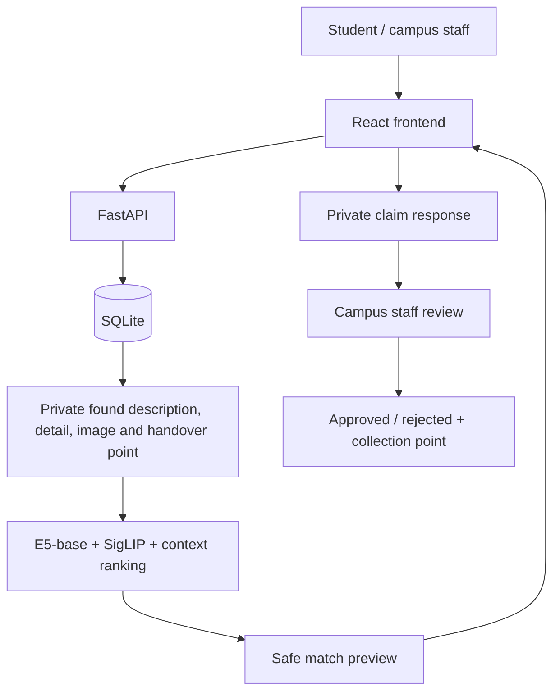

# Design notes

## Campus privacy architecture

Public found-item and match responses omit full descriptions, sub-locations, identifying details, handover points, image paths and original images. FastAPI response schemas and the image route enforce the boundary before data reaches the browser. Staff review is a portfolio demonstration protected by a local key, not production authentication.

## Data and API

One report table contains lost and found records. SQLite stores metadata, while generated filenames identify local JPEG uploads. API input never accepts an arbitrary image path. Dates and locations can be unknown; item name, description and category are required. Categories use a small fixed vocabulary. API `PUT` updates metadata; the initial UI exposes creation, browsing, image replacement and deletion.

JSON reports and multipart image uploads use separate endpoints, which keeps the request contracts simple. An invalid photo does not discard a valid report. The React form preserves the created report ID so a failed photo upload can be retried without creating a duplicate. Uploads are decoded and re-encoded, rather than trusting the extension or MIME type. No user-supplied filename controls disk paths.

## Frontend

React and TypeScript render the campus workflow. Vite proxies `/api` to FastAPI on localhost; browser requests and images use a same-origin path, so the backend needs no CORS modification. The typed client handles paginated report loading, separate photo uploads and friendly API errors. Tailwind CSS is available for utilities, while a small product stylesheet expresses the visual system. Frontend matching controls only choose a backend method; all scoring remains in Python.

The information architecture uses three primary destinations: Home, Report, and Explore. Report begins with a lost/found choice before showing the campus form. Explore contains Matches, Lost on campus, and Found notices. Lost reports provide useful recognition details; found notices and match results show privacy-safe previews. Full multimodal matching with five results is the default, while method and result-count controls remain under Advanced options. Legacy match and browse URLs redirect into Explore so old links remain usable.

## Retrieval and scoring

`matching.py` contains pure functions that are easy to test. `services.py` orchestrates those functions and embeddings and is shared by evaluation and the API. Candidate retrieval is an exhaustive scan over found reports. Ties use ascending report ID, independent of candidate order. Image-only rejects imageless queries and explicitly excludes imageless candidates. Other methods omit unavailable image terms.

Keyword-only uses token Jaccard. The contextual baseline combines this with location, time and category. Text-only and image-only use their respective embeddings. Text + image uses their relative default weights; full ranking includes all five signals.

Time decay is asymmetric: a found event before a lost event is penalized, but not excluded, because reports can contain uncertain dates. Category mismatch reduces the score but does not filter candidates. “Other” expresses uncertainty, even when both reports use it.

## Models and failure behavior

E5-base and SigLIP load lazily through process-level caches. SigLIP uses its native image processor and image-feature head. Content-addressed vector files include model ID and preprocessing version, so old MiniLM and CLIP vectors cannot be reused after the model switch. Atomic cache-file replacement avoids partially written vectors. A process lock serializes inference/cache construction for this small local app.

No model failures are converted to invented or baseline embeddings. AI errors propagate as a clear 503, with a traceback in server logs. The user can deliberately select the baseline. An evaluator failure records an explicit error and produces a nonzero exit code. The liveness endpoint does not claim AI readiness.

## Evaluation boundaries

The seed generator creates ground-truth pairs and same-family negatives, not real collected data. Images are independently rotated procedural shapes with varied backgrounds, but share item templates. They contain no written report IDs or item names. Their simplicity can inflate image retrieval scores. Some negatives duplicate text, and their dates/locations were deliberately changed; this favors contextual rules.

Development data selected E5-base and SigLIP and evaluated 204 weight combinations. The candidate stack was then frozen before creating the independent seed-9107 test split. The final test was executed once, artifacts were locked by hashes, and no post-test tuning occurred. Both splits remain synthetic and do not establish real-world performance.

## Practical limits

This application is intended for one local user. File upload replacement/deletion is not designed for concurrent mutation of the same report, and there is no cross-resource transaction spanning files and SQL. No authentication, rate limiting, distributed cache, migrations or background queues are included. Add these only after requirements justify them.
